# Link play (battles and trades between two devices)

Two players on the same Wi-Fi or phone hotspot battle or trade with each other, Android or desktop, with no server and no
account. The network is used only inside Link play and only on the local network: while you host or look for a game, and
during the link. Android asks for no permission beyond `INTERNET` (needed even for local connections). Protocol and
design: the link play pull requests (#60, #65, #64, #67 and Phase 5).

## Getting connected
1. Open Link play: START menu, **LINK** (shown once you have the Pokédex), or talk to the **Link attendant** next to the
   nurse in any Pokémon Center. Both open the same LINK menu.
2. One player picks **HOST A GAME**. The screen shows a 7-character code and the mode you will play (A switches
   **BATTLE**/**TRADE** while you wait; the host can still change it in the lobby).
3. The other player picks **FIND A HOST**: games hosted on the same network are listed with the trainer's name and mode.
   Pick one with A. If nothing is listed (some networks block the search), go back and pick **JOIN WITH A CODE** and type
   the host's code on the name keyboard, or **JOIN BY ADDRESS** with a dotted IPv4 address (`192.168.0.7`, optionally `:port`).
   The code is the host's local IPv4 address in base 32 (no 0, 1, I or O); the port is always 47840.
4. In the lobby the host chooses **MODE** and, for a battle, the **RULES** and whether the gimmicks **both** players have
   unlocked are allowed. The guest presses READY; the host presses START. Any change by the host withdraws READY.

| Host waiting | Find a host | Lobby (host) | Lobby (guest) | Pick 3 | Link attendant | Trainer card |
|---|---|---|---|---|---|---|
| 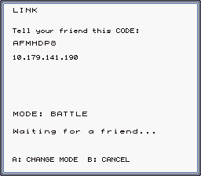 | 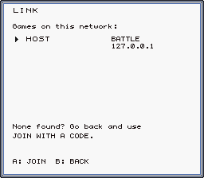 | 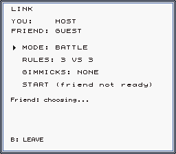 | 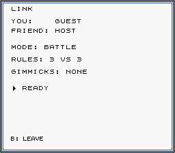 | 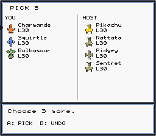 | 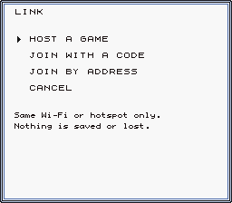 | 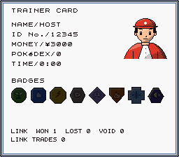 |

## Battling
- **RULES** presets: **LEVELS AS THEY ARE**; **FLAT 50** (every Pokémon at level 50 for the battle); **3 VS 3** (each player
  sees both parties and picks three, in the order they will fight; A picks or unpicks, B undoes the last pick). Your picks are
  sent as a sealed commitment and revealed only after both players have chosen, so neither can wait for the other's picks.
  3 VS 3 needs three Pokémon on both sides.
- Link battles are singles, Set style, with no bag, no running, no experience and no obedience check. **FORFEIT** replaces RUN.
- Both devices play **healed copies** of their parties. **Nothing is written to either save by the battle**, whatever happens.
  The result counts on your trainer card (link battles won, lost, drawn and void), kept with your next save.
- **A lost link** (Wi-Fi drops, the phone locks, the other game freezes): after 10 s of silence, or at once when the
  connection closes, the battle pauses with "Link lost. Reconnecting" and a countdown. If the same friend is back within
  20 s the battle goes on at the same turn (both games check every turn that they still agree). After that it is void:
  nobody wins or loses. This also covers the 3 VS 3 picks; before both teams are in, a lost link ends the session at once.
  On Android, going to the background sends a pause notice to the other device.
- Known limits: if the link drops exactly as the battle ends, one device may already show the result while the other waits
  and then calls it void (it can't know the last message arrived). The reconnect proves "the same friend" with a value
  built from what both games exchanged at the start; someone recording the Wi-Fi traffic could copy it. Link play is
  meant for friends on a trusted network.

## Trading
Each trade counts on both trainer cards (link trades), in the save that applies the swap.
Pick **MODE: TRADE** in the lobby (the guest follows the host's choice; changing it withdraws READY). Both players then:
1. Choose one **party** Pokémon. Your party is on the left; the friend's party is on the right (read-only: species, level, nickname). The last Pokémon that can battle is refused, with the reason shown.
2. See both offers side by side: species, level, nickname, OT, held item and moves. Pick **CONFIRM** or **CANCEL**.
3. Wait through **Saving...** (no input is accepted). The trade is written to the save as a journal before anything moves, and
   the swap is saved in one atomic write, so a crash or a lost link never leaves a damaged save or half a trade on a device.
   While waiting for the friend to confirm, B still backs out. If the link drops during the save, see "An interrupted trade" below.
4. The two Pokémon swap on screen ("trade" sound), then "NAME traded X for Y!". A Pokémon that evolves by trade (with its held
   item, e.g. Metal Coat, used up) evolves right away and the game saves again.
5. Back on the overworld. A cancel, a refused offer or a lost link ends with a sentence and nothing changed.

### An interrupted trade
If the link drops while the trade is being saved, one device may have swapped while the other has not (the friend's last
message never arrived). Neither game decides on its own what happened; closing or restarting the game changes nothing.
The unfinished trade stays in the save until the two players **link again**:

- On loading the save the game says so: "The link trade with NAME was interrupted. Link with NAME again to finish it."
  (or, on the device that already swapped, that the trade is done there and the friend's game still has to finish it).
- Linking again with the same friend (same name and trainer ID) settles it before anything else: if one device had
  swapped, the other finishes the swap now (with its trade evolution); if neither had, both keep their Pokémon. Then the
  new trade starts as usual.
- Until then the Pokémon you offered stays in your party: it can battle and gain levels, but it cannot be released,
  deposited in the PC, or traded (link or in-game). Changes it makes in the meantime (levels, a held item taken or given)
  do not travel: the friend receives it as it was offered. A link trade with someone else is refused until the
  unfinished one is settled; link battles work as usual.
- If the friend will never link again, START, **LINK**, **UNFINISHED TRADE** (listed only while a trade is unfinished) shows
  what is open and what can be lost, then **KEEP WAITING** or **CANCEL IT** (you keep your Pokémon and don't get theirs)
  / **END IT** (you already have theirs). If the friend's game had finished the trade, the friend keeps both Pokémon
  and one is lost; that is why it is a last resort.

A save that fails while a trade is being saved leaves the file exactly as it was before that save, so the game and its
save file never disagree about a trade. What can still leave a trade one-sided is outside the link: the manual way out above, a save that was damaged so the
backup save was loaded, or a new game started over the save.

| Interrupted | Load notice | LINK menu | UNFINISHED TRADE (offered) | Asked again | UNFINISHED TRADE (swapped) | Linked again |
|---|---|---|---|---|---|---|
| 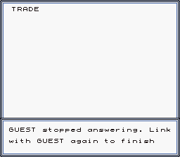 |  |  | 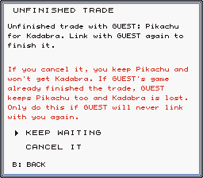 | 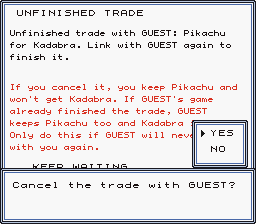 |  | 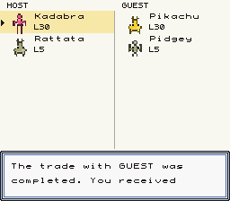 |

Also `trade_one_sided.png`: the device that swapped, in the same interrupted trade.

The received Pokémon is an outsider (level-based obedience, no nickname prompt) unless it returns to its original trainer.
Engine side: `TradeTransaction` (the reconnect rules are in `onSync`), `GameTradeStore`, `TradeJournal`, `MonValidator`, `GameContext.linkTradeLock`; screens: `LinkTradeScreen`, `LinkLobbyScreen` (UNFINISHED TRADE).

| Lobby (trade) | Pick | Offers | Saving | Swap | Result | Evolution |
|---|---|---|---|---|---|---|
|  | 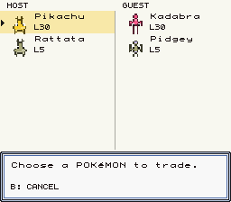 | 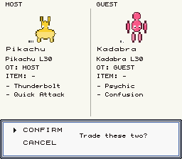 |  |  | 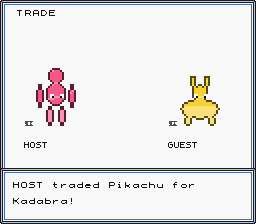 |  |

Also `trade_evolved.png` (the evolution's last message), and `trade_guest_lobby.png`, `trade_guest_offers.png`, `trade_guest_result.png` (the guest's side).

## Where the code is
- `engine/.../link`: messages, handshake, `LockstepBattle`, lobby messages, address codes, `LinkLobbyRules` (no sockets).
- `core/.../game/link`: `TcpTransport` (`java.net`, a reader and a writer thread, frames handed to the game thread with
  `Gdx.app.postRunnable`), `LinkDiscovery` (UDP broadcast: the host announces on port 47841 and answers queries on
  47842; the guest listens on 47841 and asks on 47842, so one direction a network filters is enough), `LobbySession`
  (presets), `LinkLobbyScreen` (menu, find a host, pick 3, the reconnect during a battle), `LinkResultScreen`, `LinkTradeScreen`.
- The grace period is `LockstepBattle.resume` (engine); `LinkLobbyScreen.driveReconnect` listens again (host) or connects
  again once a second (guest).
- The Link attendant: `world/scripts/p5_link.pks` calls the script hook `special link`.
- `BattleScreen` and `BattleFlow` take a local side (the guest is side 1) and a `LockstepBattle`.
- `Platform.localAddresses()`; the Android manifest asks for `INTERNET` (needed for local sockets too).

## Testing on one machine
- Desktop automation (`--script`): `link host [PORT] [flat] [trade]`, `link join CODE|ADDRESS[:PORT]`, `linkplay fight | forfeit TURN`,
  `ot` (give the party's Pokémon the player as original trainer), `waitstate trade=PICK|CONFIRM|SAVING|SCENE` and `waitstate mode=TRADE`
  (the top link screen's state), `link menu` (the LINK menu), `mashuntil TEXT` (A until the top screen matches) and the
  fault `dropprepared` on `link host`/`link join` (this device's trade frames are lost from its PREPARED on),
  `link find [NAME]` (join by discovery) and `three` on `link host`/`link find`/`link join` (the 3 VS 3 preset; picks the first three).
- `tools/visual/run_link_scene.sh [battle|forfeit|killed|trade|resume|discovery]` starts two instances under Xvfb on localhost, plays the scenario and
  checks that both show the same state hash and complementary results, that a forfeit and a killed second instance end cleanly,
  and that the survivor's save files are byte-identical before and after. The `trade` scenario swaps both first party Pokémon (the guest offers a Kadabra, so the host's evolves to Alakazam through
  `EvolutionScreen` and the second save holds it) and checks each save afterwards: slot 0 holds the other's species (Alakazam for
  the host) and OT, party sizes are unchanged, no trade journal is left. The `resume` scenario interrupts a trade on purpose
  (the guest drops its frames from its PREPARED on, so only the guest swaps), checks both saves (host PREPARED, guest
  COMMITTED), starts both games again from their saves (load notices, the UNFINISHED TRADE page) and links them again:
  the host finishes the trade and no journal is left. The `discovery` scenario has the guest find the host by discovery
  (no code typed), plays a 3 VS 3 battle that the guest forfeits at its first decision, checks the same state hash and that
  neither save changed, and captures the trainer card with the new win.
  Output in `build/link-scene/`.
- `desktop/automation/link/attendant.txt`: the Link attendant in Fernwick's Pokémon Center opens the LINK menu.
- Desktop to Android emulator: the emulator reaches the host PC at `10.0.2.2` (JOIN BY ADDRESS `10.0.2.2`); the other direction
  needs `adb forward tcp:47840 tcp:47840` and the PC joins `127.0.0.1`.
